# tinynet — a neural network from scratch in NumPy

   

A small, readable deep-learning library built **without any ML framework** — no
PyTorch, TensorFlow or scikit-learn. Every forward pass, every gradient and
every optimizer update is written by hand in NumPy (~1,100 lines including plotting), verified with
numerical gradient checking, and demonstrated on eight experiments — including
**98.27 % test accuracy on MNIST** and a **Kaggle Digit Recognizer score of 0.99517** (top ~250) with its own convolutional layers.

**[Try the live demo: draw a digit and watch the network read it](https://larp321.github.io/neural-network-from-scratch/)**

Even the charts below are drawn by a dependency-free SVG/PNG plotter written
for this project.

<p align="center">
  
  
</p>
<p align="center"><em>Three interleaved spirals. A linear model can only draw straight lines (50.7% test accuracy);
a 2-hidden-layer network learns the curved boundary (99.3%).</em></p>

## Live demo: draw a digit

The trained network also runs **in the browser**. You write a digit on squared paper,
where each square is one of the 784 pixels the network sees. It predicts as you write,
circles its answer in red pen, and shows how likely every digit is and which neurons fire.

<p align="center">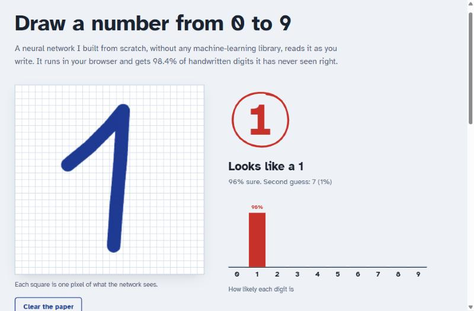</p>

**Try it live: [larp321.github.io/neural-network-from-scratch](https://larp321.github.io/neural-network-from-scratch/)**
(works on phones too). Offline, open [`web/index.html`](web) in any browser. There's no server or install;
it works straight from the folder.

How the demo is built:
* [`web/train_demo_model.py`](web/train_demo_model.py) trains on MNIST **plus generated digits in writing
  styles MNIST lacks** (see experiment 7 below).
* [`web/export_model.py`](web/export_model.py) compresses the weights to **8-bit integers**
  (one scale per neuron). The model is 4× smaller with no loss in test accuracy (98.41% → 98.43%).
* [`web/app.js`](web/app.js) re-implements the forward pass in plain JavaScript, with no libraries.
  Drawings get the same preprocessing as MNIST: crop, scale to 20×20, centre by centre of mass.
* On load, the page checks itself against reference outputs from Python and agrees to within **5e-5**.

---

## Features

| | |
|---|---|
| **Layers** | `Dense` (He / Xavier init, L2 weight decay), `Conv2D` (im2col), `MaxPool2D`, `Reshape`/`Flatten`, `Dropout` (inverted); float32 or float64 |
| **Activations** | `ReLU`, `LeakyReLU`, `Sigmoid`, `Tanh` (numerically stable) |
| **Losses** | `SoftmaxCrossEntropy` (with label smoothing), `BinaryCrossEntropy`, `MSE` — fused with their output activation for stability |
| **Optimizers** | `SGD`, momentum, Nesterov, `RMSProp`, `Adam`; global-norm gradient clipping |
| **Training** | mini-batch loop, validation tracking, early stopping with best-weight restore, `StepDecay` / `CosineDecay` LR schedules |
| **Utilities** | save/load weights (`.npz`), model summary, accuracy, confusion matrix, precision/recall/F1 report |
| **Data** | XOR, spirals, moons, circles, sine regression, MNIST loader, synthetic handwriting in 26 styles, train/test split, standardisation |
| **Verification** | finite-difference gradient checker; 32 unit tests |
| **Plots** | loss curves, decision boundaries, regression fits, confusion matrices — pure-Python SVG + PNG encoder |

## Quick start

```bash
git clone https://github.com/Larp321/neural-network-from-scratch.git
cd neural-network-from-scratch
pip install -r requirements.txt          # just numpy
python examples/spiral.py                # train + write plots to docs/images/
python -m unittest discover -s tests -v  # run the test-suite
```

```python
import numpy as np
from tinynet import Sequential, Dense, ReLU, SoftmaxCrossEntropy, Adam
from tinynet.datasets import make_moons

X, y = make_moons(500, noise=0.2)
model = Sequential([Dense(2, 32), ReLU(), Dense(32, 32), ReLU(), Dense(32, 2)])
history = model.fit(X, y, SoftmaxCrossEntropy(), Adam(lr=0.01), epochs=100, batch_size=32)
print(model.summary())
print("accuracy:", np.mean(model.predict(X) == y))
```

## Experiments

All numbers below come from running the scripts in [`examples/`](examples) with fixed random seeds.

### 1. XOR — why hidden layers matter — [`examples/xor.py`](examples/xor.py)
XOR isn't linearly separable. A 2-4-1 tanh network (17 parameters) solves it in ~50 epochs:

| x₁ | x₂ | target | P(y=1) |
|:-:|:-:|:-:|:-:|
| 0 | 0 | 0 | 0.000 |
| 0 | 1 | 1 | 0.998 |
| 1 | 0 | 1 | 0.998 |
| 1 | 1 | 0 | 0.002 |

<p align="center"> </p>

### 2. Spirals — linear vs deep — [`examples/spiral.py`](examples/spiral.py)
600 points, 3 classes, 75/25 split. Network: `2 → 64 → 64 → 3`, ReLU, L2 = 1e-4, Adam.

| model | test accuracy |
|---|---|
| Linear (softmax regression) | 50.7 % |
| MLP 2-64-64-3 (4,547 params) | **99.3 %** |

<p align="center">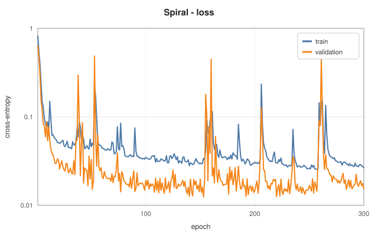 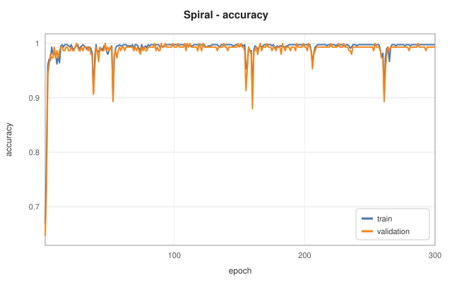</p>

### 3. Optimizer comparison — [`examples/compare_optimizers.py`](examples/compare_optimizers.py)
Identical architecture and initial weights; only the optimizer changes.

| optimizer | final training loss (200 epochs) |
|---|---|
| SGD | 0.0429 |
| SGD + momentum | 0.0261 |
| RMSProp | 0.0104 |
| Adam | 0.0114 |

<p align="center"></p>

Adaptive methods (RMSProp, Adam) reach a ~4× lower loss than plain SGD in the same number of steps.

### 4. Overfitting & regularization — [`examples/regularization.py`](examples/regularization.py)
A 2-256-256-2 network (~67k parameters) trained on only **80** noisy points, validated on 920.

| setting | train acc | validation acc | final val loss |
|---|---|---|---|
| no regularization | 98.8 % | 82.4 % | 0.911 |
| L2 weight decay (λ = 1e-2) | 87.5 % | **85.9 %** | **0.340** |
| dropout (p = 0.5) | 90.0 % | 85.1 % | 0.489 |

Without regularization the network memorises the training set — note the islands
drawn around individual noisy points — and its validation loss climbs after epoch 7.
L2 and dropout trade a little training accuracy for better generalisation.

<p align="center">
  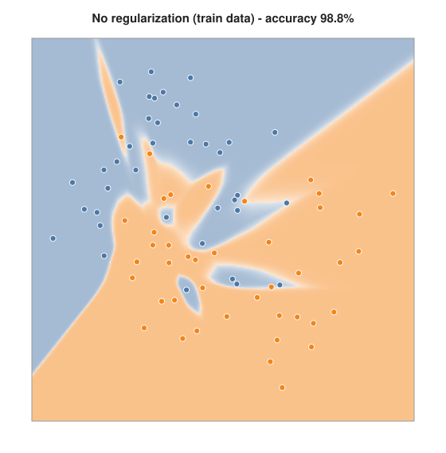 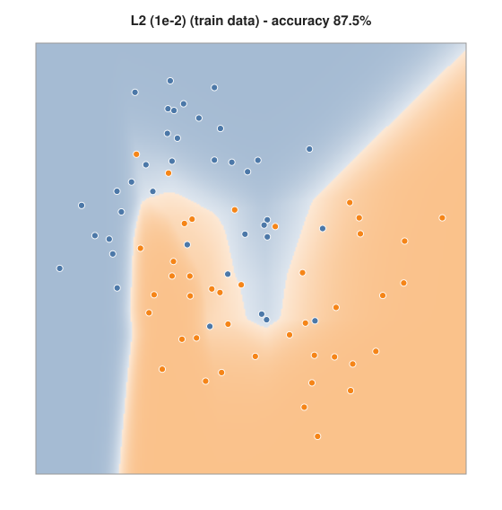 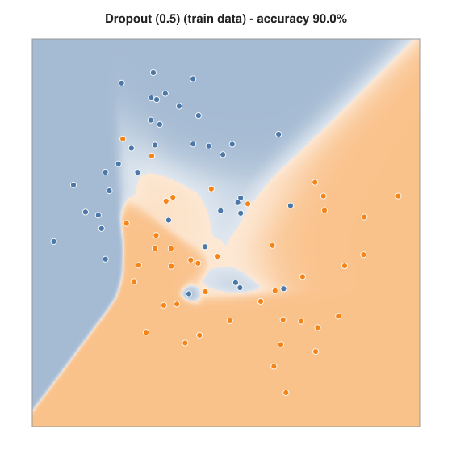
</p>
<p align="center"></p>

### 5. Regression — [`examples/regression.py`](examples/regression.py)
Fitting `sin(x)` from 200 noisy samples (noise σ = 0.15) with a 1-32-32-1 tanh network,
MSE loss and cosine learning-rate decay. RMSE against the true function: **0.019** —
the network recovers the signal, not the noise.

<p align="center">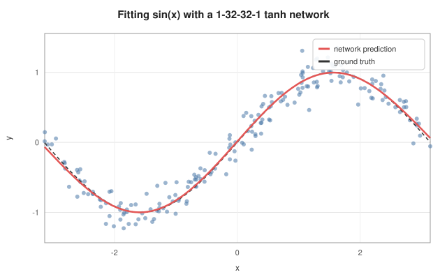</p>

### 6. MNIST handwritten digits — [`examples/mnist.py`](examples/mnist.py)
The real-world benchmark: 70,000 28×28 images of handwritten digits.
Network `784 → 256 → 128 → 10` (235,146 parameters) with ReLU, dropout 0.2, label
smoothing 0.05, Adam + step learning-rate decay and early stopping.
Trained on 55,000 images, validated on 5,000, tested on the 10,000 unseen test images.

| | |
|---|---|
| **Test accuracy** | **98.27 %** (9,827 / 10,000) |
| Training time | ~2 minutes for 12 epochs on a laptop CPU (≈9 s/epoch) |
| Per-class F1 | 0.978 (digit 9) – 0.992 (digit 1) |

```bash
python examples/mnist.py          # downloads the dataset (~11 MB) on first run
```

<p align="center">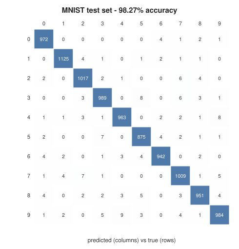 </p>

**Where it fails.** The first 20 misclassified test digits. Many are hard even for a
person: a 4 that looks like a 2, an open 6 read as a 0, a 7 with a heavy hook:

<p align="center">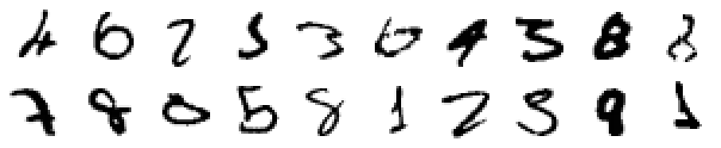</p>

The most common confusions in the matrix (4→9, 9→4, 3→5, 7→2) are the classic MNIST look-alike pairs.

**What the first layer learned.** Each tile shows one hidden neuron's 784 input weights
as a 28×28 image (red = positive, blue = negative). Neurons develop stroke- and
curve-shaped detectors. Pixels at the border are always blank in MNIST, so their weights
never receive a gradient and keep their random initial values (the speckled frame).

<p align="center"></p>

### 7. Writing styles MNIST misses — [`tinynet/handwriting.py`](tinynet/handwriting.py), [`web/train_demo_model.py`](web/train_demo_model.py)
High test accuracy didn't mean the model could read *everyone's* handwriting. MNIST was
written mostly by American writers, so styles common elsewhere are rare in it. In the web demo,
a European **1 with a long flag** came out as "maybe a 1, 36% sure", and a **slashed 0** was read as an 8.

**The fix: generate the missing data.** `tinynet/handwriting.py` draws 26 styles of the ten digits
from stroke templates (flagged and based 1s, crossed 7s, open 4s, looped 2s, slashed 0s and more).
Each one is randomised like real handwriting: slant, rotation, width, size, stroke thickness and
pen wobble. Then it goes through exactly the same preprocessing as the web page.

<p align="center">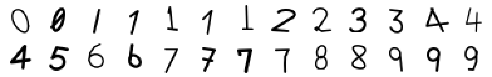</p>

I retrained the same network on MNIST plus 13,000 generated digits and measured it on 2,600
held-out ones made with a different random seed:

| style | MNIST only | MNIST + styles |
|---|---|---|
| 1 with a long flag (European) | 47.0 % | **100 %** |
| 0 with a slash | 35.0 % | **100 %** |
| 1 with flag and base | 94.0 % | 100 % |
| all 26 styles | 94.8 % | 100 % |
| **MNIST test set (10,000 real digits)** | 98.27 % | **98.41 %** |

The original benchmark *improved* too, so the extra variety helped rather than distracted.
The 100% comes from the same generator the model trained on, so it's an optimistic number.
The independent check is drawing in the real web page: 15 hand-drawn digits in these styles
were all read correctly (90–98% confident), including the European 1 that went from 36% to 98%.

### 8. Kaggle Digit Recognizer: convolutional networks — [`tinynet/conv.py`](tinynet/conv.py), [`kaggle/`](kaggle)
**Public leaderboard score: 0.99517 (tied for rank 246).**

I entered Kaggle's [Digit Recognizer](https://www.kaggle.com/competitions/digit-recognizer) competition
with networks built in tinynet. Kaggle's test digits come from MNIST, so models were trained **only on
Kaggle's own `train.csv`**, never on MNIST. Many top leaderboard scores (1.000) come from models that
have seen the test digits.

The plain network topped out around 99.1%, so I added **convolutional layers** to tinynet:
`Conv2D` (im2col, with the input gradient computed as a full convolution with the flipped kernel),
`MaxPool2D`, `Reshape` and `Flatten`. They're checked against a naive loop and by numerical gradient checks.
Profiling found two slowdowns: dropout was silently converting float32 to float64, and the first
layer computed an input-image gradient nothing used. Fixing both made training 2.6× faster.

| model (held out: 4,200 Kaggle training images) | accuracy |
|---|---|
| MLP ensemble 784-512-256-10 ×3, augmented | 99.07 % |
| CNN (conv32-conv32-pool-conv64-conv64-pool-dense256) | 99.48–99.60 % |
| **3-CNN ensemble**, 15 epochs, random shifts/rotations/scaling | **99.55 %** |
| **Kaggle public leaderboard** | **99.517 %** |

**Why it still fails.** I looked at all 19 held-out mistakes:

<p align="center">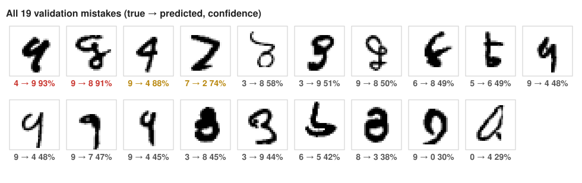</p>

* **Open-top 9s read as 4s** (5 mistakes, the largest group). At 28×28 the only difference is a 1–2 pixel gap.
  9 has the highest error rate (1.7%).
* **Ambiguous even to a person** (~5): a closed-top 4 that is a 9 in shape, a 0 written like the letter *a*,
  an 8 like *ə*. Some are probably labelling noise.
* **Thick ink merging strokes** (3): bold 3s and 6s whose gaps disappear and look like 8s.
* **Rare styles** (~6): a Z-shaped 7, a 5 with a closed bowl, very curly 3s.

The model usually knew: 15 of 19 mistakes were made at under 60% confidence, and in 18 of 19 the true
digit was its second guess.

## How it works

The design mirrors the big frameworks at a size you can read in one sitting:

```
tinynet/
├── layers.py      Dense, activations, Dropout — each has forward() and backward()
├── losses.py      loss value + gradient w.r.t. the network output
├── model.py       Sequential: forward, backward (reverse order), fit/evaluate/predict, save/load
├── optimizers.py  SGD / Momentum / Nesterov / RMSProp / Adam + LR schedules
├── gradcheck.py   numerical gradient checking
├── metrics.py     accuracy, confusion matrix, precision / recall / F1
├── datasets.py    toy datasets, preprocessing, MNIST loader
├── conv.py        Conv2D (im2col), MaxPool2D, Reshape, Flatten
├── handwriting.py synthetic digits in 26 writing styles, MNIST-style preprocessing
└── viz.py         SVG charts + a tiny PNG encoder (no matplotlib)
web/
├── train_demo_model.py  MNIST + styled digits -> the demo model
├── export_model.py  trained weights -> 8-bit model.js
└── index.html, app.js, style.css   the draw-a-digit demo
```

One training step:

```python
out  = model.forward(x_batch, training=True)     # layer by layer
loss = loss_fn.forward(out, y_batch)             # scalar
grad = loss_fn.backward()                        # dL/d(output)
model.backward(grad)                             # chain rule, reverse order; fills layer.grads
optimizer.step(model.trainable_layers())         # update every parameter
```

The full derivation of every gradient (dense layer, activations, fused
softmax-cross-entropy, Adam, etc.) is in **[docs/MATH.md](docs/MATH.md)**.

### Correctness: gradient checking
Backprop bugs often fail silently — the loss still goes down, just worse. So each
layer, activation and loss is tested against central finite differences:

```python
from tinynet.gradcheck import check_model_gradients
errors = check_model_gradients(model, X, y, SoftmaxCrossEntropy())
# {'0.W': 8.2e-10, '0.b': 2.1e-09, '2.W': 1.0e-09, '2.b': 4.4e-11}   all < 1e-6
```

### Numerical stability
* softmax and cross-entropy use the log-sum-exp trick;
* binary cross-entropy uses `max(z,0) - z·y + log(1+e^{-|z|})`;
* sigmoid switches formulas by sign so `exp` never overflows;
* tests feed logits of ±1000 to confirm results stay finite.

## What I learned
* Deriving and implementing backpropagation by hand, and proving it correct with gradient checks.
* Why initialisation (He vs Xavier), optimizer choice and regularization matter — measured, not just read about.
* Writing numerically stable maths and a clean, tested, documented Python API.

## Possible extensions
Batch normalisation · test-time augmentation · a computational-graph autograd engine · GPU support via CuPy.

## License
MIT
